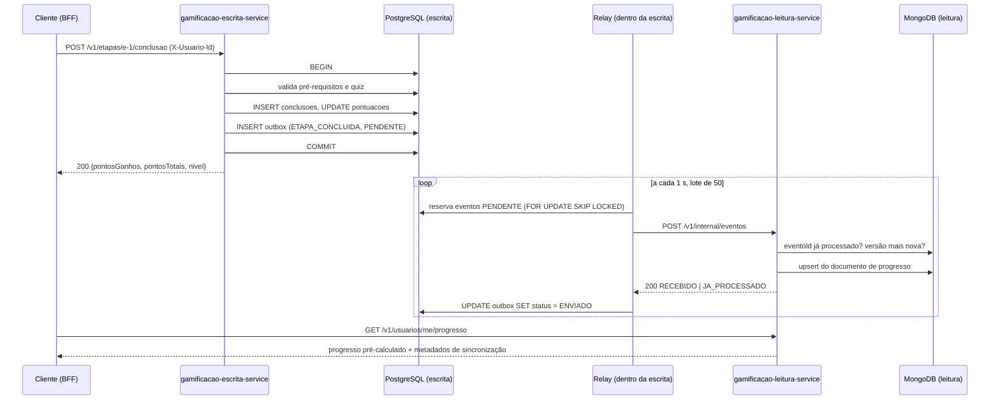

# Parte 4 — CQRS da Gamificação com Outbox e Relay

Este documento descreve a implementação do padrão CQRS no microsserviço de Gamificação da BEDARCE: os comandos gravam no **PostgreSQL** (modelo de escrita), os eventos são registrados em uma tabela **outbox** na mesma transação e um **Relay** os entrega via HTTP ao serviço de leitura, que atualiza os documentos pré-calculados no **MongoDB** (modelo de leitura).

## Visão geral do fluxo



A resposta do comando já devolve pontos e nível de forma síncrona; somente as consultas dependem da sincronização eventual, projetada para até **2 segundos**.

## Modelo de escrita — `gamificacao-escrita-service` (PostgreSQL)

O esquema (`src/schema.sql`) é criado na inicialização, protegido por *advisory lock* para que réplicas subindo juntas não disputem a migração. As trilhas iniciais (`src/seed.js`) também são publicadas pela outbox, então o catálogo chega ao MongoDB pelo mesmo caminho dos demais eventos.

| Tabela | Conteúdo |
| --- | --- |
| `trilhas` | Trilhas com público-alvo e `versao` do agregado |
| `etapas` | Etapas ordenadas (ordem única por trilha, restrição adiada para permitir reordenar), pontuação e quiz com resposta correta |
| `pontuacoes` | Pontos, nível e `versao` do agregado de progresso de cada usuário |
| `conclusoes` | Uma linha por usuário e etapa concluída (chave primária impede duplicidade) |
| `outbox` | Eventos a entregar, com as colunas definidas na arquitetura e mais `ultimo_erro` e `enviado_em` |

### Comandos

| Método | Rota | O que faz | Evento gravado |
| --- | --- | --- | --- |
| POST | `/v1/etapas/{id}/conclusao` | Conclui a etapa do usuário do cabeçalho `X-Usuario-Id` | `ETAPA_CONCLUIDA` |
| POST | `/v1/trilhas` | Cria uma trilha | `TRILHA_ATUALIZADA` |
| POST | `/v1/trilhas/{trilhaId}/etapas` | Insere uma etapa na ordem pedida, deslocando as seguintes | `TRILHA_ATUALIZADA` |

Regras da conclusão, todas dentro de uma única transação:

- `404` se a etapa não existe e `409 ETAPA_JA_CONCLUIDA` se o usuário já a concluiu;
- `403 ETAPA_BLOQUEADA` se a etapa anterior da trilha ainda não foi concluída;
- `400 QUIZ_INCORRETO` se a etapa tem questionário e alguma resposta está errada;
- a linha de `pontuacoes` do usuário é travada com `FOR UPDATE`, o que serializa conclusões simultâneas do mesmo usuário;
- nível = `1 + floor(pontos / 50)`.

> **Identidade do usuário:** o Portal usa um identificador de demonstração no cabeçalho `X-Usuario-Id`, repassado pelo Gateway e pelo BFF. A obtenção desse identificador a partir de um token autenticado é planejada.

### Outbox e Relay (`src/relay.js`)

| Regra | Implementação |
| --- | --- |
| Frequência e lote | A cada `RELAY_INTERVALO_MS` (1000) reserva até `RELAY_LOTE` (50) eventos `PENDENTE` |
| Réplicas | `FOR UPDATE SKIP LOCKED` + *lease* de 30 s em `proximo_envio`: duas réplicas nunca enviam o mesmo evento ao mesmo tempo e um envio interrompido volta a ser elegível |
| Erro transitório (rede, timeout, 5xx, 408, 429) | Nova tentativa com espera exponencial: 1 s, 2 s, 4 s… até 60 s |
| Limite de tentativas | Após `RELAY_MAX_TENTATIVAS` (10), o evento vai para `FALHA` |
| Erro permanente (demais 4xx) | `FALHA` imediata, com a resposta salva em `ultimo_erro` |
| Análise manual | `GET /v1/internal/outbox` mostra o resumo por status; `POST /v1/internal/outbox/{id}/reprocessamento` devolve um evento em `FALHA` para `PENDENTE` |

Envelope entregue ao serviço de leitura:

```json
{
  "eventoId": "d9675af0-c796-43d3-9f97-e83e7ba1cb75",
  "tipo": "ETAPA_CONCLUIDA",
  "agregadoId": "u-42",
  "ocorridoEm": "2026-11-25T20:07:47.966Z",
  "dados": {
    "usuarioId": "u-42", "etapaId": "e-1", "trilhaId": "t-1", "pontosGanhos": 10,
    "progresso": { "pontosTotais": 10, "nivel": 1, "versao": 1, "etapasConcluidas": [ "..." ] }
  }
}
```

Os eventos carregam o **estado completo e versionado** do agregado, e não apenas a diferença. Assim, aplicar o mesmo evento duas vezes, ou receber eventos fora de ordem, sempre resulta no mesmo documento final.

## Modelo de leitura — `gamificacao-leitura-service` (MongoDB)

| Coleção | Documento |
| --- | --- |
| `trilhas` | Catálogo com etapas ordenadas (quiz sem a resposta correta) e `totalEtapas` |
| `progresso` | Um documento por usuário com pontos, nível, ids das etapas concluídas por trilha, `versao`, `sincronizadoEm` e `defasagemMs` |
| `eventos_processados` | Ids dos eventos já aplicados (idempotência) |

**Idempotência** (a entrega é *at-least-once*):

1. se o `eventoId` já está em `eventos_processados`, responde `200 JA_PROCESSADO` sem reprocessar;
2. o upsert só altera o documento quando a `versao` recebida é maior que a armazenada, e snapshots antigos são descartados.

### Consultas

| Método | Rota | Resposta |
| --- | --- | --- |
| GET | `/v1/trilhas` | Trilhas ativas (filtro `publicoAlvo`, paginação); com `X-Usuario-Id`, indica `bloqueada` e `concluida` por etapa |
| GET | `/v1/trilhas/{id}` | Trilha com as etapas |
| GET | `/v1/trilhas/{trilhaId}/etapas/{etapaId}` | Conteúdo da etapa; `403` se bloqueada para o usuário |
| GET | `/v1/usuarios/me/progresso` | Progresso do usuário de `X-Usuario-Id`, com o bloco `sincronizacao` |
| GET | `/v1/usuarios/{id}/progresso` | Progresso de qualquer usuário (administrativo) |
| GET | `/v1/usuarios/{id}/nivel` | Pontos e nível |
| GET | `/v1/estatisticas/niveis` | Total de usuários por nível |
| POST | `/v1/internal/eventos` | Recebe os eventos do Relay (interna) |

Os contratos atualizados estão em [`docs/api/gamificacao.yaml`](api/gamificacao.yaml).

## Como demonstrar

Com o sistema no ar (`docker compose up -d --build`), o script abaixo roda dentro do contêiner de escrita, que alcança os dois serviços pela rede interna. Ele cria um usuário novo, conclui as quatro etapas da trilha *Primeiros passos* e, após cada escrita, faz polling no modelo de leitura até o MongoDB refletir a nova versão.

Linux, WSL ou Git Bash:

```bash
docker compose exec -T gamificacao-escrita-service node - < scripts/demo-cqrs.js
```

Windows PowerShell:

```powershell
Get-Content scripts/demo-cqrs.js -Raw | docker compose exec -T gamificacao-escrita-service node -
```

Saída observada em 25/11/2026 (trecho):

```text
=== 3. Escrita refletida na leitura (e-1, 10 pontos) ===
[ESCRITA  PostgreSQL] concluir e-1 -> HTTP 200 { pontosGanhos: 10, pontosTotais: 10, nivel: 1, ... }
[LEITURA  MongoDB   ] pontos=10 nivel=1 etapasConcluidas=1 versao=1
                      refletido após 332 ms de polling; defasagem registrada na projeção: 314 ms
Concluir e-1 de novo -> HTTP 409 ETAPA_JA_CONCLUIDA
...
[LEITURA  MongoDB   ] pontos=70 nivel=2 etapasConcluidas=4 versao=4
                      refletido após 1017 ms de polling; defasagem registrada na projeção: 980 ms

=== 5. Outbox no PostgreSQL ===
Resumo: { PENDENTE: 0, ENVIADO: 6, FALHA: 0 }
```

A defasagem ficou entre 0,3 s e 1,1 s, dentro do limite de 2 s. Ela depende do momento em que a escrita cai dentro do ciclo de 1 s do Relay.

### Passo a passo

`scripts/cqrs.sh` faz uma chamada real por comando e mostra a requisição e a resposta, para acompanhar o fluxo etapa por etapa (Linux, WSL ou Git Bash):

```bash
./scripts/cqrs.sh progresso ana          # leitura (MongoDB): 0 pontos
./scripts/cqrs.sh concluir ana e-2       # escrita: 403 ETAPA_BLOQUEADA
./scripts/cqrs.sh concluir ana e-1       # escrita (PostgreSQL): 200, 10 pontos
./scripts/cqrs.sh tabela ana             # linha em pontuacoes + evento na outbox
./scripts/cqrs.sh progresso ana          # leitura já mostra 10 pontos e a defasagem
./scripts/cqrs.sh documento ana          # documento no MongoDB
./scripts/cqrs.sh concluir ana e-3 q-1=0,q-2=1   # etapa com questionário
./scripts/cqrs.sh outbox PENDENTE        # eventos aguardando entrega
./scripts/cqrs.sh relay                  # logs do Relay
```

### Conferindo os dois bancos diretamente

```bash
# Escrita (PostgreSQL)
docker compose exec db-gamificacao-escrita psql -U bedarce -d bedarce_gamificacao \
  -c "SELECT usuario_id, pontos, nivel, versao FROM pontuacoes;" \
  -c "SELECT tipo_evento, agregado_id, status, tentativas, enviado_em - criado_em AS defasagem FROM outbox ORDER BY criado_em DESC LIMIT 5;"

# Leitura (MongoDB)
docker compose exec db-gamificacao-leitura mongosh --quiet bedarce_gamificacao_leitura \
  --eval 'db.progresso.find({}, {pontosTotais: 1, nivel: 1, versao: 1, defasagemMs: 1}).toArray()'
```

### Cenário de falha: leitura fora do ar

Este cenário mostra que a outbox não perde eventos quando o destino está indisponível:

```bash
docker compose stop gamificacao-leitura-service
./scripts/cqrs.sh concluir bia e-1       # a escrita continua respondendo 200
./scripts/cqrs.sh outbox PENDENTE        # evento retido, com tentativas e ultimo_erro
./scripts/cqrs.sh progresso bia          # leitura fora do ar: sem resposta
docker compose start gamificacao-leitura-service
./scripts/cqrs.sh relay                  # "falha ao entregar..." e depois "entregue"
./scripts/cqrs.sh progresso bia          # 10 pontos: nada se perdeu
```

Resultado observado: com a leitura parada, a conclusão respondeu `200` e o evento ficou `PENDENTE`, com `tentativas=1` e `ultimo_erro` preenchido. Ao religar o serviço, o Relay entregou o evento na tentativa seguinte, cerca de 7,6 s depois da escrita, e o documento no MongoDB foi atualizado.

### Outras verificações feitas

| Cenário | Resultado |
| --- | --- |
| Reenvio do mesmo `eventoId` | `200 JA_PROCESSADO`, documento inalterado |
| Snapshot com versão antiga | Descartado; pontos continuaram corretos |
| 5 conclusões simultâneas da mesma etapa | Uma `200` e quatro `409` |
| 2 réplicas da escrita (`--scale gamificacao-escrita-service=2`) com 40 conclusões | As réplicas dividiram as entregas (31/9), 40 eventos e 40 projeções, nenhum reenvio, defasagem máxima de 1,07 s |

## Integração pelo Gateway e BFF Portal

O Portal encaminha as requisições pela porta pública do Gateway (`GATEWAY_HOST_PORT`, por padrão `8080`), mantendo o fluxo Gateway → BFF Portal → Gateway interno → microsserviço. O identificador de usuário abaixo é provisório para testes; a autenticação ainda não está implementada.

| Método | Rota pública | Destino |
| --- | --- | --- |
| POST | `/portal/v1/gamificacao/etapas/{id}/conclusao` | Escrita: `/v1/etapas/{id}/conclusao` |
| GET | `/portal/v1/gamificacao/progresso` | Leitura: `/v1/usuarios/me/progresso` |
| GET | `/portal/v1/gamificacao/trilhas` | Leitura: `/v1/trilhas` |
| GET | `/portal/v1/gamificacao/trilhas/{id}/etapas/{etapaId}` | Leitura: `/v1/trilhas/{id}/etapas/{etapaId}` |

Na interface, a conclusão exibe os pontos ganhos retornados pela escrita. O Portal consulta o progresso a cada 500 ms, por até dez tentativas, e atualiza pontos, nível e trilhas quando a versão da projeção e o total de etapas concluídas avançam. Os resultados de defasagem acima foram medidos nos serviços de gamificação.

Na SAGA, o orquestrador chama o serviço de escrita para inscrever o mentor na trilha `t-2`. A inscrição é idempotente e fica no PostgreSQL. Esse comando não publica um evento para a projeção no MongoDB.

Exemplos para configurar no Insomnia (ajuste a porta pública conforme o `.env`):

**Consultar progresso**

```http
GET http://localhost:8080/portal/v1/gamificacao/progresso
X-Usuario-Id: teste-cqrs-20261125-a81f
```

**Concluir a primeira etapa**

```http
POST http://localhost:8080/portal/v1/gamificacao/etapas/e-1/conclusao
Content-Type: application/json
X-Usuario-Id: teste-cqrs-20261125-a81f

{
  "respostas": []
}
```

O comando retorna os pontos imediatamente; consulte o progresso novamente após o Relay sincronizar a projeção no MongoDB. Repetir a conclusão da mesma etapa retorna `409 ETAPA_JA_CONCLUIDA`. As rotas internas do Relay e da outbox não são encaminhadas pela porta pública do Gateway.
